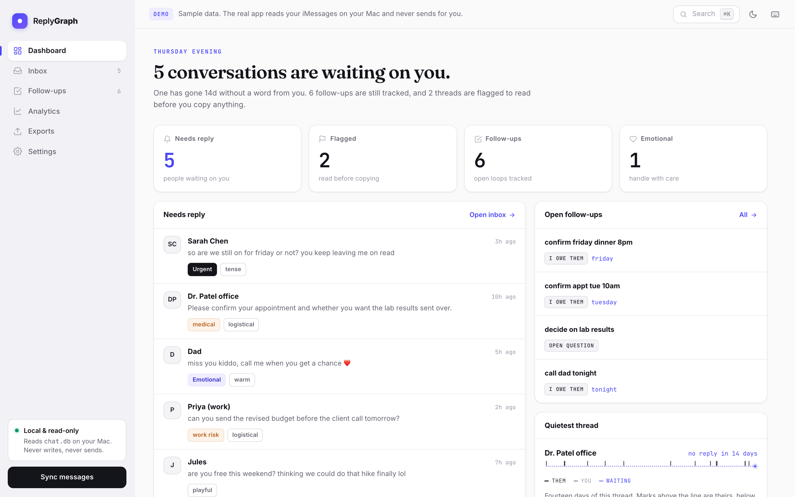
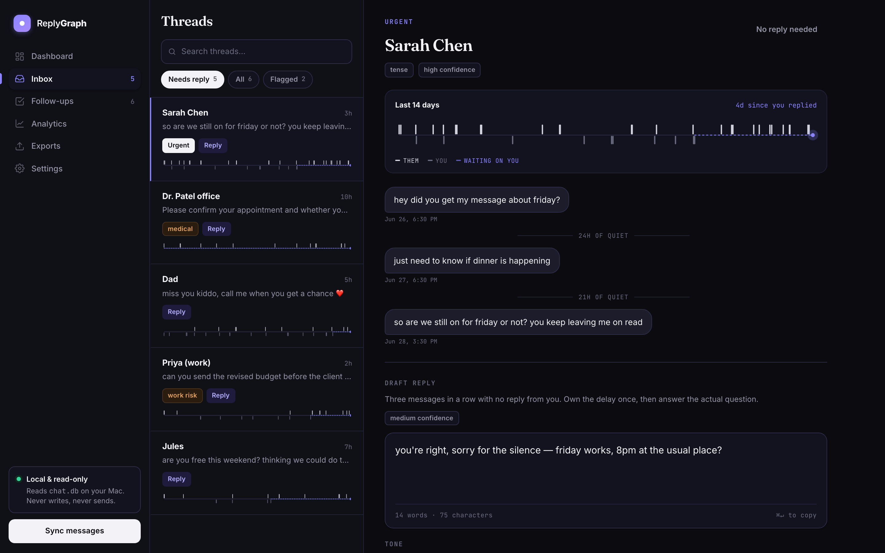

# ReplyGraph



A private, local-first macOS app that reads your own iMessage history, ranks
which conversations need attention, drafts replies in your voice, flags risky
tone, extracts follow-ups, and exports summaries to Markdown / Obsidian.

**Local-first. Read-only. No auto-send.** Your messages stay on your Mac.

> There is also a static, sample-data **demo** of the interface (no backend, no
> real messages) at [`replygraph/demo/index.html`](./demo/index.html), published
> via GitHub Pages at `/replygraph/`. The instructions below are for the *real*
> app under `replygraph/`.

---

## The interface

ReplyGraph is a two-pane desktop app that collapses to a single column with a
native-style tab bar on a phone. Both the real app and the demo share one
stylesheet, so they look and behave the same.

**The pulse graph.** Every thread gets a two-week strip: their messages tick
above the line, yours below, and the shaded stretch on the right is everything
since you last wrote back. A thread you have gone quiet on is visible at a
glance, without reading a word of it. It appears in the thread list, the thread
header, and each analytics card.



**Driven from the keyboard.**

| Key | Action |
| --- | --- |
| `⌘K` | Command palette — sections, threads, and actions |
| `/` | Search threads |
| `G` then `D I F A E S` | Jump to a section |
| `J` / `K` | Next / previous thread |
| `1` `2` `3` | Casual / warm / professional tone (demo) |
| `C` | Copy the draft |
| `⌘↵` | Copy the draft from inside the composer |
| `T` | Toggle theme |
| `?` | Shortcut sheet |

**Everything else.** Light and dark themes that follow your system setting and
persist your choice; drafts that type themselves in when you change tone or
rewrite; counters that animate on the dashboard; live thread search with match
highlighting; and full `prefers-reduced-motion` support — every animation is
disabled when you ask for that, and the results still land correctly.

### Working on the UI

`frontend/src/styles.css` is the single source of truth for the design system.
The demo is a self-contained single file, so its copy of the CSS is generated:

```bash
node demo/sync-styles.mjs          # after editing styles.css
node demo/sync-styles.mjs --check  # fails if the demo is stale
```

To regenerate the screenshots:

```bash
npm i -D playwright && npx playwright install chromium
node demo/shot.mjs
node demo/shot_mobile.mjs
```

---

## What it does

- Reads recent iMessage threads from `~/Library/Messages/chat.db` (read-only).
- Ranks threads (urgent / emotional / logistical / work / low-priority / risky).
- Generates a draft reply per thread (offline heuristics, or a real LLM if you add a key).
- 13 one-click rewrites (shorter, nicer, more direct, say no politely, calmer, …).
- Flags risky tone (defensive, apologetic, vague, cold, angry, …) with suggestions.
- Extracts follow-ups (things you owe, things owed to you, scheduling loops, open questions).
- Simple relationship analytics, labelled as **estimates** with confidence.
- Approve / edit / deny / copy workflow — **copy-to-clipboard only**.
- Customisable dashboard, Markdown + Obsidian export, token-usage estimates.
- A pulse graph per thread showing two weeks of cadence and how long they have
  been waiting on you.

## What it does NOT do

- Does **not** send messages, and never uses AppleScript to send in v1.
- Does **not** bypass macOS permissions or ask for your Apple ID / passwords / 2FA.
- Does **not** upload messages anywhere unless you explicitly configure an LLM API key.
- Does **not** diagnose people or make absolute claims about relationships.

## Privacy principles

- All message data stays local by default (SQLite + JSON on your machine).
- The Messages database is opened **read-only**; ReplyGraph never writes to it.
- Emotional/relationship analytics are estimates with confidence labels, not facts.
- Nothing leaves your machine unless you turn off *local-only mode* and add an API key.

---

## Requirements

- macOS (for real iMessage access; the app also runs on Linux for development with the dev seed).
- Python 3.11+
- Node 18+

## Setup & run

The app is two processes: a FastAPI backend and a Vite/React frontend.

### 1. Backend

```bash
cd replygraph/backend
python3 -m venv .venv
source .venv/bin/activate
pip install -r requirements.txt

# run from the replygraph/ directory so the `backend` package resolves
cd ..
uvicorn backend.main:app --port 8000 --reload
```

Backend is now on http://localhost:8000 (`/health` shows iMessage status).

### 2. Frontend

```bash
cd replygraph/frontend
npm install
npm run dev
```

Open http://localhost:5173. The dev server proxies `/api/*` to the backend.

### 3. Grant iMessage access (macOS)

`~/Library/Messages/chat.db` is protected. Grant **Full Disk Access** to whatever
runs the backend (e.g. Terminal or iTerm):

1. System Settings → Privacy & Security → **Full Disk Access**
2. Toggle on **Terminal** (or your terminal app).
3. Quit and reopen the terminal, then restart the backend.

`/health` (and the in-app banner) will show **connected** once access works.

### 4. Sync your messages

Click **Sync Messages** in the sidebar (or `POST /sync/imessage`). ReplyGraph pulls
the most recent threads (default 50 threads × 50 messages — configurable in Settings).
If access fails, you get a clear permission error and the app keeps running.

---

## Without a Mac / for development

There is no `chat.db` on Linux, so a **dev-only synthetic seed** lets you exercise
the whole analysis pipeline:

```bash
cd replygraph
source backend/.venv/bin/activate
python -m backend.dev_seed     # loads sample threads into the local DB
uvicorn backend.main:app --port 8000
```

This is **not** a product feature — it only exists to verify ranking, tone,
follow-ups, drafts and analytics where a real Messages database is unavailable.

---

## How things work

- **Drafts** — `draft_generator.py` runs in two modes. *Mock mode* (default, offline)
  produces safe placeholder drafts from heuristics. *LLM mode* uses your configured
  Claude API key to draft in your voice, injecting your style profile into the prompt.
- **Approve / edit / deny / copy** — every decision is stored. Copy puts the draft on
  your clipboard (browser Clipboard API, backend `pbcopy` fallback). Nothing is sent.
- **Style learning** — when you edit or approve, `style_profile.py` updates simple,
  transparent preferences (e.g. shorter replies, fewer apologies) and snapshots history.
  No model training.
- **Tone risk** — `tone_risk_detector.py` flags defensive / apologetic / vague / cold /
  angry / needy drafts and offers a calmer rewrite. Sensitive flags (medical, money,
  legal, conflict, work) show *review carefully* and stay copy-only.
- **Follow-ups** — `followup_extractor.py` pulls promises, requests, scheduling loops
  and unanswered questions, each with a direction and confidence.
- **Dashboard customisation** — show/hide and reorder widgets, compact/spacious density,
  pin contacts/threads, choose the default tab; stored locally with a reset button.
- **Obsidian export** — set a vault path in Settings; ReplyGraph writes summaries into
  `/ReplyGraph/Daily|Contacts|Followups|Analytics/` with YAML frontmatter and wiki links.
- **Token strategy** — `token_estimator.py` estimates usage with editable pricing; the
  app processes recent threads first and caches summaries rather than resending history.
- **Pulse graph** — `frontend/src/components/Pulse.jsx` draws each thread's last
  14 days from message timestamps alone. The shaded band starts at your most
  recent outgoing message, so it measures how long they have been waiting rather
  than how long since anyone spoke.

## Known limitations

- iMessage access depends on macOS Full Disk Access; some macOS versions are stricter.
- Ranking, tone and analytics are **heuristics** — useful signals, not ground truth.
- Offline mock drafts are intentionally generic; real drafting needs an API key.
- v1 is single-user, single-machine, no auth.

## Future work

- Gmail / Outlook / Slack / Teams connectors
- Notion export
- Optional AppleScript sending (explicit opt-in)
- Better local-LLM support
- Full relationship graph
